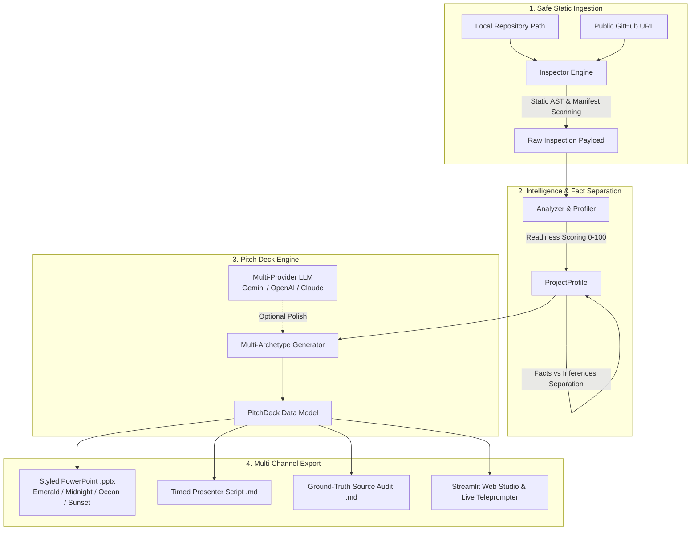

# 🎯 AI Demo-to-Deck — Code-to-Pitch Intelligence Agent

[](https://www.python.org/downloads/)
[](https://streamlit.io)
[](LICENSE)
[](#architecture)

**AI Demo-to-Deck** is an intelligent developer-to-investor translation agent that turns any software repository into an executive, publication-ready PowerPoint presentation, timed speaker script, and defensible ground-truth audit.

---

## 🌟 Why Demo-to-Deck?

Engineers and founders spend dozens of hours manually preparing slides, while investors and non-technical stakeholders often struggle to understand the code or suspect exaggerated claims. 

Demo-to-Deck solves this with **strict ground-truth separation**:
* **🟢 Verified Facts (`[FACT]`)**: Statements extracted and verified directly from repository manifests (`package.json`, `pyproject.toml`, `requirements.txt`), documentation, test suites, and Dockerfiles.
* **🟡 Inferred Claims (`[INFERRED]`)**: Interpretations, value propositions, and capability heuristics generated by the analyzer, clearly tagged with analyzer confidence scores.

Presenters can pitch with total confidence knowing every slide is backed by an audit trail.

---

## 🏗️ Architecture & Dataflow



---

## ✨ Key Capabilities

### 1. 💼 Four Specialized Pitch Archetypes
* **Investor Seed Pitch (7 slides)**: The Opportunity, Core Product, Technical Moat, Live Demo Steps, Traction & Verified Facts, and The Ask.
* **Technical Architecture (6 slides)**: System Topology, Dependency Manifests, Key File Roles, Pipeline Walkthrough, and Developer Runbook.
* **Customer Walkthrough (5 slides)**: The Customer Challenge, How We Solve It, UX Journey, Instant Time-to-Value, and Getting Started.
* **Lightning / Hackathon (4 slides)**: 90-second high-energy pitch: The Hook, Innovation, Live Demo Moment, and Next Steps.

### 2. 🎨 Executive Slide Themes
* **🌲 Modern Emerald**: Forest Green (`#0F382C`) & Jade (`#10B981`)
* **🌌 Midnight Tech**: Dark Mode Slate (`#0B0F19`), Indigo (`#6366F1`), and Cyan
* **🌊 Corporate Ocean**: Deep Navy (`#0C4A6E`) & Cobalt Blue (`#2563EB`)
* **🌅 Sunset Stone**: Warm Charcoal (`#1C1917`) & Vivid Tangerine (`#F97316`)

### 3. 🤖 Multi-Provider AI Studio Support
* **Google Gemini** (`gemini-1.5-flash`, `gemini-1.5-pro`): Native high-speed REST integration.
* **OpenAI & OpenAI-Compatible** (`gpt-4o-mini`, `gpt-4o`, Groq, Ollama, DeepSeek).
* **Anthropic Claude** (`claude-3-5-sonnet-20241022`): Messages API integration.
* **Local Deterministic Engine**: Safe rule-based generation with zero external API dependencies.

### 4. 🎙️ Live Teleprompter & Interactive Studio
* **Interactive Slide Canvas**: Live-edit slide titles, bullet points, speaking notes, and durations in the UI.
* **Live Teleprompter**: Full-screen teleprompter mode with slide-by-slide progress, speech pacing indicators (~130 words/min), and cue reminders.
* **Modern Browser Mockup Generator**: Generates clean, framed macOS-style browser window previews when live capture is unavailable.

---

## 🚀 Quickstart Guide

### 1. Clone & Set Up Environment

```bash
git clone https://github.com/kingofallsnakes/AI-Demo-to-Deck.git
cd AI-Demo-to-Deck

# Create and activate virtual environment
python -m venv .venv

# Windows PowerShell:
.\.venv\Scripts\Activate.ps1

# Linux / macOS:
source .venv/bin/activate

# Install dependencies
pip install -r requirements.txt
```

---

### 2. Launch the Web Studio (Streamlit)

```bash
python run.py
```
*(Or run `streamlit run app.py`)*

Open your browser at **http://localhost:8501**.

---

### 3. Command Line Interface (CLI)

Run Demo-to-Deck directly from the terminal without a browser:

```bash
# Generate investor deck on the included sample demo app
python run.py --cli sample_demo_app

# Generate technical architecture deck in Midnight Dark theme timed for 3 minutes
python run.py --cli . --archetype tech_demo --theme midnight --duration 3

# Analyze any public GitHub repository directly
python run.py --cli https://github.com/streamlit/demo-self-driving --archetype investor --theme ocean
```

All generated deliverables are saved to the `output/` directory.

---

### 4. Safe Sample Demo App (Included)

Demo-to-Deck includes a lightweight, safe sample application in `sample_demo_app/` to test live screenshot capture:

```bash
python sample_demo_app/server.py
```
Open **http://127.0.0.1:8765** to view the sample demo.

---

## 📦 Output Deliverables

When Demo-to-Deck runs, it produces a complete package in `output/`:

| Artifact | File Pattern | Description |
|---|---|---|
| **PowerPoint Deck** | `*_deck.pptx` | Editable 16:9 presentation with custom theme, card shapes, embedded speaker notes, and screenshot frames. |
| **Timed Script** | `*_script.md` | Spoken presentation script with cumulative timestamps (`0:00 - 0:45`), pacing guidance, and visual cues. |
| **Source Notes Audit** | `*_source_notes.md` | Complete verification audit trail separating `[FACT]` from `[INFERRED]` claims. |
| **Structured JSON** | `*_bundle.json` | Full machine-readable deck representation. |
| **Profile JSON** | `*_profile.json` | Raw static analysis data, readiness score, and tech stack signals. |

---

## ⚙️ Configuration (`.env`)

AI enhancement is completely optional. If no API key is provided, Demo-to-Deck runs locally and deterministically.

Copy `.env.example` to `.env`:

```env
# Option 1: Google Gemini (Recommended)
GEMINI_API_KEY=AIzaSy...
GEMINI_MODEL=gemini-1.5-flash

# Option 2: OpenAI / OpenAI-Compatible (Groq, Ollama, DeepSeek)
OPENAI_API_KEY=sk-...
OPENAI_MODEL=gpt-4o-mini
# OPENAI_BASE_URL=https://api.openai.com/v1

# Option 3: Anthropic Claude
ANTHROPIC_API_KEY=sk-ant-...
ANTHROPIC_MODEL=claude-3-5-sonnet-20241022
```

---

## 📁 Repository Structure

```
AI-Demo-to-Deck/
├── .streamlit/
│   └── config.toml          # Custom theme configuration for Streamlit
├── output/
│   └── .gitkeep             # Destination folder for generated presentation deliverables
├── sample_demo_app/
│   ├── index.html           # Safe sample web app for screenshot capture
│   ├── server.py            # Stdlib HTTP test server (zero external dependencies)
│   └── README.md
├── src/
│   └── demo_to_deck/
│       ├── __init__.py      # Top-level public package exports
│       ├── __main__.py      # CLI execution handler
│       ├── models.py        # Domain models (Profile, Slide, PitchDeck, Archetype, Theme)
│       ├── analyzer/
│       │   └── profile.py   # Fact vs inference classifier & readiness grader
│       ├── deck/
│       │   └── export.py    # Multi-theme python-pptx PowerPoint exporter
│       ├── generator/
│       │   ├── pitch.py     # Slide builder & timed pacing calculator
│       │   └── llm.py       # Multi-provider AI enhancement (Gemini, OpenAI, Claude)
│       ├── inspector/
│       │   ├── filesystem.py# Static AST scanning & manifest parser
│       │   ├── github.py    # Anonymous public GitHub repository fetcher
│       │   └── local.py     # Local path static scanner
│       └── screenshots/
│           └── capture.py   # Window mockup renderer & URL screenshot capture
├── tests/
│   └── test_demo_to_deck.py # Comprehensive unit and end-to-end test suite
├── .env.example             # Template for API keys
├── .gitignore               # Strict exclusion of caches, virtualenvs, and secrets
├── app.py                   # Streamlit web application & live studio
├── pyproject.toml           # Standard Python package specifications
├── requirements.txt         # Core dependencies
├── run.py                   # Unified launcher (GUI / CLI)
└── README.md                # Project documentation
```

---

## 🧪 Running Tests

Run the complete automated test suite:

```bash
# Using standard Python unittest
python -m unittest discover tests

# Or using pytest (if installed)
pytest -v
```

---

## 🛡️ Safety & Security Principles

* **Read-Only Static Inspection**: Demo-to-Deck never executes untrusted code from scanned repositories.
* **No Secret Leakage**: Public GitHub repos are fetched anonymously; local inspection never touches `.env` files or credentials.
* **Deterministic Fallback**: Can operate 100% offline without network connectivity or API tokens.

---

## 📄 License

This project is licensed under the [MIT License](LICENSE).
